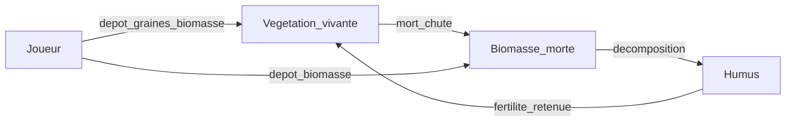
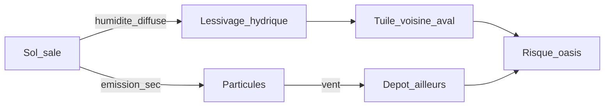

# Gaïa — Roadmap système écologique

Source design : [`Proposition système écologique.pdf`](./Proposition%20syst%C3%A8me%20%C3%A9cologique.pdf) (2026-10-13).  
Suivi produit global : [`ROADMAP.md`](../ROADMAP.md) · tech Godot : [`BACKLOG.md`](../BACKLOG.md).

Ce fichier = **piste E** (écosystème de dépollution).  
**v0 Oasis** (P1–P5 / G2–G3) reste prioritaire. E0–E1 peuvent suivre ou chevaucher le polish Oasis ; E4–E6 = éco riche (après win/lose v0 sauf démarrage anticipé figé ici).

---

## 0. Vision

Ne plus « faire disparaître » la pollution : **transformer un terrain mort en écosystème autonome**.

Trois couches conceptuelles :

| Couche | Exemples | Rôle |
|---|---|---|
| **Matières** | eau, terre, polluants, biomasse, humus | conservées, transportées, transformées |
| **Organismes** | plantes, champignons | croissent, consomment, meurent, colonisent |
| **Fonctions** | dépollution, fixation, filtration, décomposition | émergent de la présence des organismes |

**Hybride (décision)** : le joueur dépose graines, plants ou biomasse ; ensuite la nature reprend la main (propagation, concurrence, mort, enrichissement).  
On ne construit pas une forêt case par case : on restaure jusqu’à l’autonomie.

**Règle persistants** : absorber ≠ détruire. Les toxiques persistants sont stockés dans la biomasse et peuvent être relâchés à la mort ; le joueur doit parfois **récolter / retirer**.



---

## 1. État Godot actuel (point de départ)

| Élément | Aujourd’hui | Cible piste E |
|---|---|---|
| Pollution | 1 scalaire 0–100 + hotspots + **migration 2 canaux (proto)** | 4 familles (voir §2) |
| Sol / humidité | baseline + overrides eco | + humus, biomasse, contamination |
| Végétation | `veg` + arbres si fertilité | 6 familles, coefficients |
| Source / capillarité | `WaterSource` + `EcoSim` | conserve ; nourrit succession |
| Deck Semis | prévu P3-4 (Mousses / Arbustes / Mycélium) | E0 mappe coefficients PDF |
| Graines / herbier | — | E4 |

Fichiers clés : `scripts/world/cell_data.gd`, `eco_sim.gd`, `water_source.gd`, `tree_scatter.gd`.

---

## 2. Quatre types de pollution

Limiter à quatre familles pour ne pas exploser les paramètres.

| Pollution | Comportement | Traitement privilégié |
|---|---|---|
| **Chimique** | Se dissout, infiltre, absorbable | Plantes dépolluantes, filtration |
| **Particulaire** | Poussières / cendres ; vent | Couvre-sols, pluie, fixation |
| **Toxique persistante** | Contamine durablement | Extraction, confinement, retrait biomasse |
| **Organique** | Déchets biodégradables ; peut fermenter | Décomposition / compostage |

**Organique** peut devenir une **ressource** (humus), mais matière **contaminée** ≠ matière saine : la décomposition ne rend pas les toxiques inoffensifs.

### 2.1 Migration de la pollution (décision 2026-10-13) — proto Godot

Deux canaux **distincts** (un scalaire pollution pour l’instant ; split E1 plus tard) :

| Canal | Condition | Effet |
|---|---|---|
| **Hydrique** | Sol humide + flux d’humidité (diffusion / pluie) | Pollution dissoute **suit l’eau** (humide → plus sec). Avec la capillarité source → **exfiltration vers l’extérieur**, pas un aimant vers le beacon. |
| **Particulaire** | Sol assez sale + assez sec | Le sol **émet** ; le **vent** transporte et **redépose** surtout sur sol sec (peu de dépôt sur cœur humide d’oasis). |

Conséquences gameplay :

- L’eau de source **chasse / dilue** un peu le cœur (rinçage).  
- La menace sur l’oasis = surtout **retombées particulaires sur la lisière** (sol plus sec) + plus tard pluie/ruissellement P2.  
- Artefact évité : anneau de hotspots + vent qui empilait la poussière au centre.

Implémentation proto : `EcoSim` (`_diffuse_moisture_and_hydric`, `_particulate_wind`), tick jour via `WorldManager`. Zone sim limitée (`POLLUTION_SIM_RADIUS`) autour des sources + tuiles hotspot.



---

## 3. Six familles de végétation

Chaque famille = **coefficients** (eau / humus / dépol / érosion…), pas un moteur séparé.

| # | Famille | Rôle | Traits |
|---|---|---|---|
| 1 | **Mousses & lichens** | Pionniers | Lents, résistants, peu de terre, piègent poussières |
| 2 | **Herbes & couvre-sols** | Protecteurs | Rapides, peu d’eau, anti-érosion, débris |
| 3 | **Plantes dépolluantes** | Extractrices | Absorption ciblée ; biomasse parfois contaminée |
| 4 | **Roseaux & humides** | Filtreuses | Beaucoup d’eau, filtration, zones humides |
| 5 | **Arbustes & arbres** | Biomasse | Lents, ombre, racines profondes, beaucoup de débris |
| 6 | **Champignons** | Recycleurs | Humidité, décomposition → nutriments / humus |

### Mapping Semis (brief / P3-4)

Le PDF **enrichit** la famille Semis — pas un second système « Dépolluer ».

| Famille PDF | Deck Semis v0 | Suite |
|---|---|---|
| Mousses & lichens | **Semis Mousses** | — |
| Arbustes & arbres | **Semis Arbustes** | — |
| Champignons | **Semis Mycélium** | — |
| Herbes, extractrices, roseaux | — | Herbier / E4–E6 |

Valeurs indicatives (à équilibrer) : conso eau / prod. humus / dépol / protection érosion sur une échelle 1–5 par famille.

---

## 4. Cycle de la matière végétale (3 stocks / tuile)

| Stock | Contenu |
|---|---|
| **Végétation vivante** | Plantes présentes ; croissent, boivent, meurent |
| **Biomasse morte** | Chute, racines mortes, dépôt joueur (+ **taux de contamination**) |
| **Humus** | Matière stabilisée ; fertilité + rétention d’eau |

Action joueur **déposer biomasse** (paille, feuilles, broyat) :

- protection érosion immédiate  
- ↓ évaporation  
- humus progressif  
- risque fermentation / pollution organique si trop + manque d’O₂  

Un seul stock biomasse + **taux contamination** suffit (pas deux stocks sains/contaminés).

---

## 5. Interactions / stratégies (compromis)

| Situation | Conséquence |
|---|---|
| Beaucoup de plantes, peu de décomposeurs | Accumulation biomasse morte |
| Biomasse + humidité OK | Humus rapide |
| Sol pollué + extractrices | Pollution **déplacée** vers biomasse |
| Biomasse contaminée → compost | Risque de contaminer l’humus |
| Sol nu + vent fort | Envol particules / érosion |
| Couverture dense | Protection + rétention d’eau |
| Humus + pluie | Réserve d’eau ↑, croissance ↑ |

Chaque solution a un coût (eau, contamination, concurrence spatiale).

---

## 6. Stocks Sol / Air (intégration V4)

| Sol | Air |
|---|---|
| Eau | Humidité |
| Terre minérale | Poussières |
| Pollution chimique | Pollution atmosphérique |
| Pollution persistante | Pollens / spores |
| Pollution organique | — |
| Végétation vivante | — |
| Biomasse morte | — |
| Humus | — |

Matières : gravité / vent. Organismes : colonisation des tuiles voisines.

---

## 7. Succession écologique (mécanique phare)

Le joueur ne plante pas une forêt mature sur un sol stérile.

| Phase | État | Ce qui se passe |
|---|---|---|
| **1 — Stérile** | Mort | Eau, ↓ pollution, dépôt biomasse |
| **2 — Colonisation** | Pionniers | Mousses ; premiers débris |
| **3 — Fertile** | Herbes + décomposeurs | Humus ; rétention d’eau |
| **4 — Mature** | Arbustes / arbres | Autonomie progressive |

Non linéaire : zone humide → roselière plutôt que forêt ; sécheresse → **régression**.

---

## 8. Banque de graines & herbier

Interprétation ludique de la *soil seed bank*.

### États sur tuile (stock caché à la génération)

Enfouies · bloquées (croûte pollution) · dormantes · libérées.

**Déterministe à la gen** : le nettoyage **révèle** le stock ; une fois épuisé, plus de graines anciennes (pas de farm).

### Trois mécanismes

1. **Découverte au nettoyage** — chance de réveiller / libérer ; zones très polluées = découvertes intéressantes, sans inventer des graines.  
2. **Récolte sur végétation mature** — enrichit l’inventaire.  
3. **Dispersion naturelle** — vent / eau / gravité.

### Herbier ≠ inventaire

| | Herbier | Inventaire |
|---|---|---|
| Contenu | Espèces **connues** (collection) | **Quantités** plantables |
| Progression | Déblocage définitif | Consommation / gain |

Mémoire écologique de la carte : marais mort → graines de roseaux ; ancienne forêt → sous-bois ; sans liste énorme par tuile (profil biome / historique).

### Boucle

```
Dépolluer → découvrir / réveiller graines
  → planter & restaurer ailleurs
    → produire graines, biomasse, humus
      → écosystème autonome
```

Plaisir double : surprise (renaissance sur place) + satisfaction (propager ailleurs). Rares : cadeau inventaire possible.

---

## 9. Phasage `E*` (IDs stables)

| ID | Statut | Contenu | Dépend / alignement |
|---|---|---|---|
| **E0** | todo | Spec coefficients eau / humus / dépol / érosion pour **3 Semis** ; stocks **biomasse morte + humus** minimaux sur tuile | G1-5b, P3-4 |
| **E1** | todo | Split pollutions : chimique + organique d’abord ; particulaire (vent) ; persistante ensuite | G1-3 |
| **E2** | todo | Cycle vivant → morte → humus ; évap / érosion si couvert | E0 |
| **E3** | todo | Succession phases 1–4 + colonisation voisins (hybride) | E2, arbres fertilité |
| **E4** | todo | Banque de graines + herbier / inventaire | E1, P3 deck |
| **E5** | todo | Extractrices + biomasse contaminée + récolte / retrait | E1 persistante, E2 |
| **E6** | todo | Roseaux / zones humides + régression climatique | P2 pluie / vent |

**Priorité** : E0–E1 après / en parallèle du polish Oasis.  
**E4–E6** : v1 éco riche (idéalement après P5-5), sauf décision contraire écrite.

Tech miroir : `GE-*` dans [`BACKLOG.md`](../BACKLOG.md).

---

## 10. Questions ouvertes (piste E)

| ID | Question | Impact |
|---|---|---|
| **QE1** | Split 4 pollutions dès E1, ou score agrégé HUD + types internes ? | E1, layers |
| **QE2** | Inventaire graines : UI Godot dès E4, ou stub debug ? | E4 |
| **QE3** | Combien d’espèces herbier v1 ? (PDF : 6 slots) | E4 |

---

## 11. Lien brief / décisions figées

- Enrichit **Semis** (Mousses / Arbustes / Mycélium) — ne réintroduit pas Dépolluer séparé ([`ROADMAP.md`](../ROADMAP.md) §1.5).  
- Antagoniste = climat + héritage pollution ; pas de villes / routes.  
- SIG montre les stocks ; la partie = 1 geste → monde résout (tours P2–P3).
